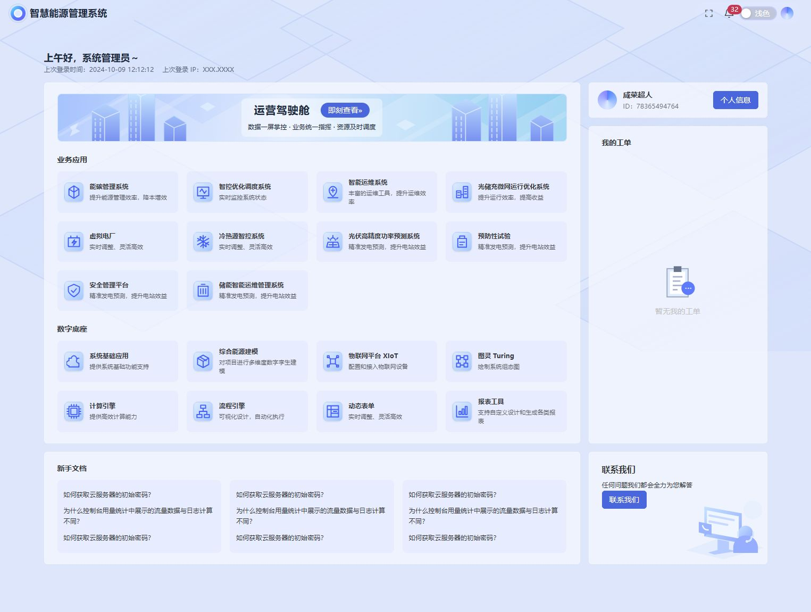

# 智慧能源管理首页实现说明

## 范围与入口

默认入口为 `src/views/Home.vue`，通过 `App.vue` 异步加载。页面使用 Vue 3、TypeScript、Naive UI 和 Tailwind CSS，未增加依赖，未接入真实 API。

首页用户、登录记录、32 条消息角标、应用和帮助文档均为本地演示数据。工单展示空状态；应用入口、个人信息、文档和联系我们打开本地弹窗，不会发起业务请求或跳转到未配置的地址。全屏和主题切换在浏览器本地执行，手动主题选择在刷新后恢复为跟随系统。

## 文件职责

| 文件 | 职责 |
| --- | --- |
| `src/views/Home.vue` | 语义结构、问候区、页面背景及桌面共享行布局 |
| `src/components/home/HomeHeader.vue` | 系统标识、全屏、消息、主题和头像 |
| `src/components/home/ApplicationPanel.vue` | 驾驶舱横幅、业务应用、数字底座及演示弹窗 |
| `src/components/home/AppEntryCard.vue` | 可键盘访问的应用入口卡片 |
| `src/components/home/HomeSidebar.vue` | 个人信息、工单空状态和联系说明 |
| `src/components/home/HelpPanel.vue` | 三组文档和本地阅读弹窗 |
| `src/data/home.ts` | 10 个业务应用、8 个数字底座及其他演示内容 |
| `src/assets/home/` | 本地 SVG 建筑横幅、几何背景、联系插画 |
| `src/App.vue` | 中文配置、明暗主题和面板颜色 |

## 布局与可访问性

- 1280px 及以上应用入口为四列，640px 至 1279px 为两列，更窄屏幕为单列。
- 1024px 及以上使用主区与侧栏约 3:1 的布局，并通过 CSS subgrid 对齐应用区与工单、文档与联系卡片。更窄屏幕按 DOM 顺序展示主内容、文档、用户与服务。
- 页面保留单个 `main` 和 `h1`；模块使用具名 `section` 和 `aside`。装饰图形不向读屏软件重复播报。
- 操作用按钮，正文跳转使用链接；图标按钮具备可访问名称，入口卡片及文档具备可见焦点。
- 正文跳转链接在键盘聚焦后显示，可直接将焦点移入 `main`；弹窗采用 Naive UI 的焦点管理和 Escape 关闭行为。
- 移动端文档按钮最小高度 44px；长文案自然换行，不以隐藏内容消除溢出。
- 标准布局面向支持 Tailwind CSS 4 和 CSS subgrid 的现代浏览器，未验收旧版浏览器和真实移动设备。

## 与设计稿的差异

| 项目 | 当前实现及原因 |
| --- | --- |
| Logo 与头像 | 使用本地渐变图形近似，未取得原始素材 |
| 建筑、应用图标、工单及联系插画 | 使用自行绘制的 SVG，几何造型、光影与原稿存在差异 |
| 背景 | 使用本地几何图案及浅蓝底色近似，线条位置和透明度未逐像素匹配 |
| 字体与间距 | 使用系统字体和现有组件，字号、行高、按钮大小及部分卡片高度略有不同；长标题和文档会换行 |
| 横幅按钮 | 使用实色蓝底白字，保证浅色横幅在深色模式下也有清晰对比度 |
| 虚线边框 | 截图中的图标和素材虚线框视为标注边界，未作为产品样式复制 |
| 文档与联系方式 | 保留原稿重复的文档排列，补充演示正文；未虚构真实客服地址或联系方式 |
| 移动端 | 原稿未提供移动设计，当前采用单列阅读顺序和可操作的触控区域 |
| 深色模式 | 原稿仅有浅色截图，深色视觉为适配实现 |
| 业务行为 | 不连接真实系统；消息、用户信息和应用入口仅作本地演示 |

## 验证结果

2026-11-06 在当前工作区运行：

| 验证 | 结果 |
| --- | --- |
| `npm run check` | ESLint、类型检查、Vitest 和生产构建全部通过；7 个测试文件、27 个用例 |
| `git diff --check` | 通过 |
| 1525px 桌面 | 四列入口、双栏布局；工单底部与应用区底部、联系卡片顶部与文档区顶部对齐 |
| 1024px 中屏 | 双列入口、侧栏正常，无页面横向溢出 |
| 375px 手机视口 | 单列入口、文档与侧栏顺序合理，无页面横向溢出 |
| 交互 | 全屏进出、明暗切换、消息与用户浮层、个人信息、文档、应用及联系弹窗已验收 |
| 键盘 | Tab 导航、正文跳转、Enter 打开入口、Escape 关闭及焦点恢复已验证 |
| 日志 | 开发热更新过程中曾记录全局样式重复挂载提示；全新页面加载及交互复核未记录警告或错误 |

这些结果为自动检查和桌面浏览器中的响应式验收，不代表真实 API、真实手机或所有浏览器兼容性验证。

## 截图

桌面截图使用 1525 × 1150 视口，比原稿高度更高以完整展示底部模块。手机截图为 375px 视口下的整页内容，截图内容宽度不包含滚动条。

[查看手机整页截图](images/home-mobile.png)
